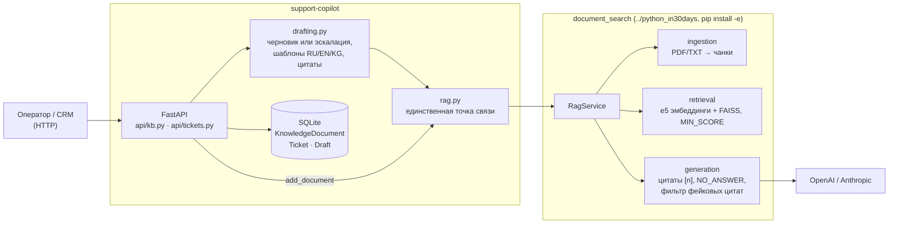
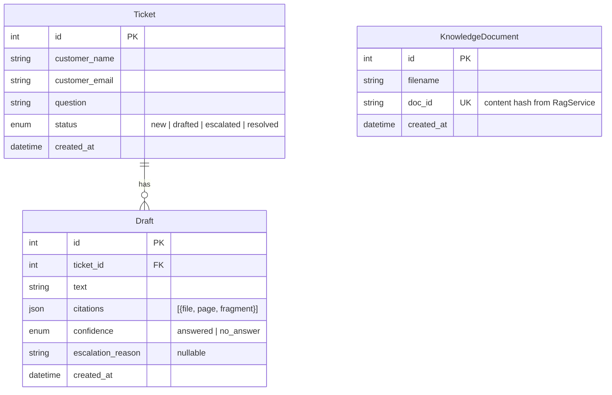

# AI Customer Support Copilot

> **AI support copilot backend:** drafts polite, source-cited replies to customer tickets in Russian, English and Kyrgyz from a company knowledge base.
> **Stack:** Python 3.13, FastAPI, SQLModel/SQLite, pytest; RAG on FAISS + multilingual-e5 + OpenAI/Anthropic via my [intelligent-document-search](https://github.com/Erbolka23/intelligent-document-search) engine.
> **Key idea:** escalation instead of hallucination — if an answer can't be backed by a valid citation, the ticket goes to a human operator with a clear reason.

Бэкенд помощника службы поддержки. Оператор загружает базу знаний компании (правила доставки, возвратов, оплаты, гарантии), клиенты присылают вопросы, а Copilot по каждому тикету пишет **черновик вежливого ответа с источниками** на языке клиента (RU / EN / KG). Если ответ нельзя подтвердить документами, тикет **эскалируется** оператору с понятной причиной. Отправлять клиенту ничего самостоятельно Copilot не умеет: последнее слово всегда за человеком (`resolve`).

Поиск и генерацию выполняет мой RAG-движок [`document_search`](https://github.com/Erbolka23/intelligent-document-search) (локальная папка `python_in30days`; FAISS + sentence-transformers, ответы с цитатами `[n]`, протокол `NO_ANSWER`, фильтр фейковых цитат). Он подключён **как зависимость**, без копирования кода. Copilot — отдельный слой бизнес-логики поверх `RagService`: тикеты, черновики, статусы, эскалация.

## Как принимается решение

`POST /tickets/{id}/draft` вызывает `RagService.ask(question)` и смотрит на результат:

| Ситуация | Статус тикета | `escalation_reason` |
|---|---|---|
| Ответ найден и подтверждён хотя бы одной валидной цитатой | `drafted` | — |
| Модель ответила `NO_ANSWER` (в документах этого нет) | `escalated` | `no_answer_in_kb` + пояснение модели |
| Ни один фрагмент не прошёл порог `MIN_SCORE`, или база знаний пуста | `escalated` | `no_relevant_documents` (LLM не вызывается) |
| Ответ без цитат, с несуществующей `[7]` или пустой | `escalated` | `no_valid_citations` |
| LLM недоступна или не настроена (режим retrieval-only) | `escalated` | `llm_unavailable` (+ код: `auth`, `network`, `quota`, …) |
| Модель эмбеддингов упала | `escalated` | `embedding_unavailable` |

Черновик сохраняется в обоих случаях. При эскалации `confidence = no_answer`, а в `text` лежит заметка для оператора. Если упала только LLM, к заметке прикладываются найденные фрагменты, чтобы оператор мог ответить вручную. Неподтверждённый ответ модели в черновик не попадает никогда.

Готовый ответ выглядит так: приветствие по имени, ответ, вежливое завершение, подпись `служба поддержки {COMPANY_NAME}` и список источников. Маркеры `[n]` в тексте перенумерованы под этот список. Несколько фрагментов одного файла (и одной страницы PDF) идут под одним номером.

```
Саламатсызбы, Жыпар Мамытова!

Ноутбуктарга кепилдик 24 айга берилет [1].

Дагы суроолоруңуз болсо, ушул катка жооп жазыңыз — жардам берүүгө даярбыз.

Урматтоо менен,
колдоо кызматы TechNomad

Булактар:
[1] warranty.txt
```

## Архитектура





Переходы статусов: `new → drafted | escalated`. Повторный `draft` разрешён из `drafted` и `escalated`, например после пополнения базы знаний. `resolve` разрешён только из `drafted`.

### Структура

```
support-copilot/
├─ src/support_copilot/
│  ├─ config.py      # CopilotSettings: свой .env, пути от корня проекта
│  ├─ models.py      # SQLModel-таблицы, статусы
│  ├─ db.py          # engine SQLite (foreign keys ON), create_all
│  ├─ schemas.py     # тела запросов/ответов
│  ├─ rag.py         # Settings для document_search и сборка RagService
│  ├─ drafting.py    # бизнес-логика: черновик / эскалация, шаблоны, цитаты
│  ├─ api/           # app.py (фабрика), kb.py, tickets.py, deps.py
│  └─ main.py        # uvicorn support_copilot.main:app
├─ tests/            # pytest; фейковые эмбеддер и LLM в conftest.py
├─ demo/             # база знаний TechNomad + seed.py
├─ Dockerfile  .env.example  pyproject.toml
```

## Установка на Windows

Нужны Python 3.12+ (проверено на 3.13) и рядом лежащая папка `python_in30days`:

```
Desktop/
├─ python_in30days/   # RAG-движок document_search
└─ support-copilot/   # этот проект
```

PowerShell, из папки `support-copilot`:

```powershell
py -3.13 -m venv venv
.\venv\Scripts\Activate.ps1          # если запрещено: Set-ExecutionPolicy -Scope CurrentUser RemoteSigned

python -m pip install --upgrade pip
pip install -e ..\python_in30days    # RAG-движок как зависимость (тянет torch, ~1–2 ГБ)
pip install -e ".[dev]"              # сам Copilot + pytest, httpx, ruff

Copy-Item .env.example .env          # и впишите ключ LLM
```

При первом запросе к поиску скачается модель `intfloat/multilingual-e5-small` (~470 МБ, один раз, в кэш Hugging Face).

### Конфигурация (`.env`)

| Переменная | По умолчанию | Назначение |
|---|---|---|
| `LLM_PROVIDER` | `anthropic` | `openai`, `anthropic` или `none` (`none` → все тикеты эскалируются) |
| `OPENAI_API_KEY` / `ANTHROPIC_API_KEY` | — | ключ выбранного провайдера |
| `LLM_MODEL` | пусто | пусто → модель провайдера по умолчанию |
| `COMPANY_NAME` | пусто | подпись в письмах |
| `DATA_DIR` | `data` | SQLite (`copilot.db`) и индекс RAG (`rag/`) |
| `DATABASE_URL` | пусто | пусто → `sqlite:///{DATA_DIR}/copilot.db` |
| `MAX_UPLOAD_MB` | `10` | больше → `413` |
| `MIN_SCORE` | `0.75` | порог релевантности, откалиброван под e5-small |
| `TOP_K`, `CHUNK_MAX_CHARS`, `MAX_DOCUMENTS`, … | | см. `.env.example` |

Copilot читает **только свой** `support-copilot/.env`. Настройки для `document_search` собираются в `rag.py` явно (`_env_file=None`, абсолютный `data_dir`), поэтому `.env` и папка `data/` проекта `python_in30days` не используются. `.env` внесён в `.gitignore`.

## Запуск

```powershell
uvicorn support_copilot.main:app --reload
```

- Swagger UI: http://127.0.0.1:8000/docs
- Health: http://127.0.0.1:8000/health → `{"status":"ok","documents":4,"llm_enabled":true}`

## Примеры запросов

> **Кириллица и curl в Windows.** Если передать кириллицу прямо в аргументе `-d`, `curl.exe` отправит её не в UTF-8, и сервер ответит `400 There was an error parsing the body`. Поэтому JSON с русским текстом кладите в файл, сохранённый в UTF-8, и отправляйте через `--data-binary @file.json`. В PowerShell `curl` — это алиас `Invoke-WebRequest`, поэтому пишите `curl.exe`.

Git Bash или cmd (`curl.exe`):

```bash
# База знаний
curl -X POST http://127.0.0.1:8000/kb/upload -F "file=@demo/kb/delivery.txt"
curl http://127.0.0.1:8000/kb

# Тикет: латиница прямо в аргументе
curl -X POST http://127.0.0.1:8000/tickets -H "Content-Type: application/json" \
     -d '{"customer_name":"John","customer_email":"john@example.com","question":"How much is delivery to Osh?"}'

# Тикет с кириллицей — из UTF-8 файла
# ticket.json: {"customer_name":"Айгуль","customer_email":"aigul@example.com","question":"Сколько стоит доставка в Ош?"}
curl -X POST http://127.0.0.1:8000/tickets -H "Content-Type: application/json" --data-binary @ticket.json

curl -X POST http://127.0.0.1:8000/tickets/1/draft      # черновик или эскалация
curl http://127.0.0.1:8000/tickets/1                    # тикет + все черновики
curl "http://127.0.0.1:8000/tickets?status=escalated"   # фильтр по статусу
curl -X POST http://127.0.0.1:8000/tickets/1/resolve    # оператор подтвердил
```

PowerShell (тело нужно передать UTF-8 байтами):

```powershell
$body = @{ customer_name = "Бакыт"; customer_email = "bakyt@example.com"
           question = "Можно ли вернуть наушники?" } | ConvertTo-Json
$t = Invoke-RestMethod -Method Post http://127.0.0.1:8000/tickets `
       -ContentType "application/json; charset=utf-8" -Body ([Text.Encoding]::UTF8.GetBytes($body))
$d = Invoke-RestMethod -Method Post "http://127.0.0.1:8000/tickets/$($t.id)/draft"
$d.ticket.status; $d.draft.escalation_reason; $d.draft.text
```

Ответ `POST /tickets/1/draft` (сокращено):

```json
{
  "ticket": {"id": 1, "status": "drafted", "...": "..."},
  "draft": {
    "id": 1, "ticket_id": 1, "confidence": "answered", "escalation_reason": null,
    "text": "Здравствуйте, Айгуль!\n\nДоставка в Ош стоит 350 сом, срок доставки составляет 2–3 рабочих дня [1].\n\n…\n\nИсточники:\n[1] delivery.txt",
    "citations": [{"file": "delivery.txt", "page": null, "fragment": "Ош и Джалал-Абад — 2–3 рабочих дня, стоимость 350 сом. …"}]
  }
}
```

## Эндпоинты и ошибки

| Метод | Путь | Успех | Ошибки |
|---|---|---|---|
| `POST` | `/kb/upload` (multipart `file`) | `201`; `200` + `duplicate: true` для уже загруженного файла | `413` больше `MAX_UPLOAD_MB` · `422` не PDF/TXT, пустой файл, нет имени · `409` лимит документов · `503` модель эмбеддингов недоступна |
| `GET` | `/kb` | `200` | |
| `POST` | `/tickets` | `201` | `422` пустой вопрос/имя, невалидный email, вопрос > 5000 символов |
| `GET` | `/tickets?status=` | `200` | `422` неизвестный статус |
| `GET` | `/tickets/{id}` | `200` (тикет + черновики) | `404` |
| `POST` | `/tickets/{id}/draft` | `201` — и для `drafted`, и для `escalated` (недоступная LLM — это эскалация, а не ошибка сервера) | `404` · `409` тикет уже `resolved` |
| `POST` | `/tickets/{id}/resolve` | `200` | `404` · `409` тикет не в статусе `drafted` |
| `GET` | `/health` | `200` | |

Собственные ошибки приходят в одном формате: `{"detail": {"code": "ticket_not_found", "message": "Ticket 42 does not exist."}}`. Ошибки валидации — в стандартном формате FastAPI (`detail` — список полей).

## Демо: интернет-магазин TechNomad

В `demo/kb/` лежат четыре документа вымышленного магазина электроники с доставкой по Кыргызстану: `delivery.txt`, `returns.txt`, `payment.txt`, `warranty.txt`. Скрипт `demo/seed.py` загружает их, создаёт 10 тикетов на трёх языках и запрашивает черновик для каждого. Нужен рабочий ключ LLM в `.env`.

```powershell
python demo/seed.py --reset          # чистый прогон, данные в demo/data
python demo/seed.py --reset --full   # + полный текст каждого письма
python demo/seed.py --url http://127.0.0.1:8000   # против запущенного сервера
```

Результат прогона (OpenAI `gpt-4o-mini`, e5-small, `MIN_SCORE=0.75`):

| # | Язык | Вопрос | Результат |
|---|---|---|---|
| 1 | RU | Сколько стоит доставка в Ош и сколько ждать? | ✅ drafted — 350 сом, 2–3 рабочих дня |
| 2 | RU | Можно вернуть вскрытые наушники-вкладыши? | ✅ drafted — нельзя, по гигиеническим причинам |
| 3 | EN | Can I pay cash to the courier in Bishkek? | ✅ drafted — да, только Бишкек и Чуйская обл. |
| 4 | RU | Какая гарантия на ноутбук и куда нести? | ✅ drafted — 24 месяца, сервисный центр |
| 5 | KG | Ноутбукка кепилдик канча убакытка берилет? | ✅ drafted — 24 ай, письмо полностью на кыргызском |
| 6 | RU | Когда вернут деньги на карту? | ✅ drafted — 5–10 рабочих дней |
| 7 | EN | Does the warranty cover a cracked screen? | ✅ drafted — нет, механические повреждения |
| 8 | RU | Есть ли программа лояльности? | ⛔ escalated — `no_answer_in_kb` |
| 9 | RU | Продаёте восстановленные iPhone? | ⛔ escalated — `no_answer_in_kb` |
| 10 | RU | Принимаете trade-in? | ⛔ escalated — `no_answer_in_kb` |

`Summary: 7 drafted, 3 escalated; 10/10 as expected.` Если результат разойдётся с ожидаемым, скрипт завершится с кодом 1. Формулировки ответов LLM от прогона к прогону немного отличаются.

## Тесты

```powershell
pytest -q
```

Тесты не скачивают модели и не ходят во внешние API: в `tests/conftest.py` лежат детерминированный `HashingEmbedder` и `FakeLLM` (по образцу тестов `python_in30days`). Каждый тест получает свою SQLite-базу и свой индекс. Покрыто:
- каждый эндпоинт;
- все причины эскалации;
- сбои LLM (`auth`, `network`, неожиданное исключение SDK) и эмбеддера;
- ошибки 404/409/413/422;
- три языка ответа;
- перенумерация и склейка цитат;
- жизненный цикл `escalated → draft → drafted → resolved`.

## Docker

`document_search` нет в PyPI, поэтому его исходники передаются вторым build context (нужен BuildKit, Docker 23+):

```powershell
docker build --build-context rag=..\python_in30days -t support-copilot .
docker run --rm -p 8000:8000 --env-file .env -v copilot-data:/app/data support-copilot
```

В образ попадают только `pyproject.toml`, `README.md` и `src/` движка — его `.env`, `data/` и `venv/` не копируются. Torch ставится в CPU-сборке, модель e5 запекается в образ, поэтому поиск работает без интернета. Данные (SQLite и индекс) лежат в томе `/app/data`.

## Ограничения MVP

- **Нет аутентификации и rate limiting.** Сервис рассчитан на внутреннюю сеть или работу за API-шлюзом.
- **Один процесс.** `RagService` держит индекс в памяти под внутрипроцессной блокировкой, а SQLite не рассчитана на конкурентную запись. Запускайте с одним воркером uvicorn.
- **Две независимые точки хранения.** SQLite (тикеты, список документов) и индекс RAG не связаны транзакцией. Удаления документов из базы знаний пока нет. Если удалить `data/rag`, оставив `copilot.db`, список `/kb` перестанет совпадать с индексом.
- **413 проверяется после приёма тела.** Starlette сначала принимает multipart во временный файл, и только потом приложение проверяет размер. В продакшене ограничивайте тело на прокси (`client_max_body_size` в nginx).
- **Эскалация вопросов «по теме» держится на LLM.** Вопросы вроде «есть ли trade-in?» набирают 0.81–0.85 и проходят порог `MIN_SCORE=0.75`. Эскалируются они потому, что модель отвечает `NO_ANSWER` или не даёт валидной цитаты, а не из-за порога.
- **Определение языка эвристическое.** RU/EN решается подсчётом кириллицы и латиницы, поэтому русский вопрос с большим количеством латиницы («зарядка USB-C Power Delivery 65W для MacBook Air M2») получит английский шаблон. Кыргызский определяется по буквам `ң/ө/ү` и списку частых слов. Если язык не определён, используется русский.
- **Генерация синхронная.** `POST /draft` ждёт LLM (обычно несколько секунд) прямо в запросе. Очереди нет.
- **Черновик нельзя отредактировать** перед `resolve`, и Copilot не отправляет письма: `resolved` означает «оператор подтвердил», а отправка остаётся за CRM.
- **Заметки об эскалации — на русском** (язык операторов). Письма клиентам — на языке вопроса.
- **Миграций нет.** Схема создаётся через `create_all`, поэтому при изменении моделей нужна новая база или Alembic.
